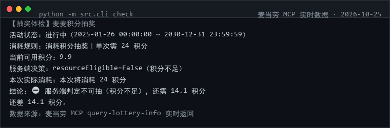
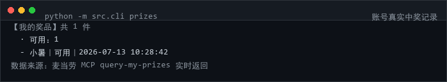
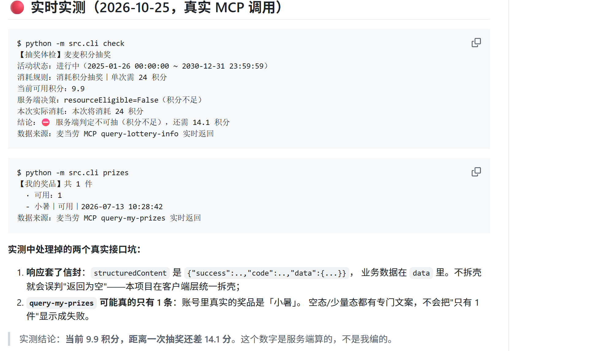

# 🎰 mcd-prize-radar · 麦门抽奖情报局

> 🌐 **在线展示页**：https://susevenci.github.io/mcd-prize-radar/（GitHub Pages，含真实运行截图；仓库地址见文末）

> ⭐ **觉得有用就点个 Star** —— 本项目正在参加麦当劳程序员创意开发大赛，排名唯一依据就是 Star 数。**零依赖、可离线运行，无需 Token 也能验证。**


> 积分抽奖这件事，官方 App 只告诉你「点这里抽」。
> 本项目回答另外四个问题：**现在到底能不能抽 · 还差多少分 · 奖池里有什么 · 攒分路径在哪**。

**诚实三原则**（贯穿全部代码）：
① **绝不编概率** —— MCP 不返回概率，本项目就一个百分比数字都不输出；
② **能不能抽听服务端** —— 以 `drawDecision.resourceEligible` 为唯一真相，绝不靠 `availableTimes` 自行推断；
③ **默认不抽** —— `draw` 子命令必须先展示本次消耗，且要显式 `--confirm` 才发起。

```
$ python -m src.cli check --offline

【抽奖体检】麦麦积分抽奖
活动状态：进行中（2025-01-26 00:00:00 ~ 2030-12-31 23:59:59）
消耗规则：消耗积分抽奖｜单次需 24 积分
当前可用积分：9.9
服务端决策：resourceEligible=False（积分不足）
本次实际消耗：本次将消耗 24 积分
结论：⛔ 服务端判定不可抽（积分不足），还需 14.1 积分
还差 14.1 积分。
```

> 这段输出来自 **2026-10-25 的真实 MCP 调用快照**（`samples/lottery_sample.json`），
> 不是编出来的演示文案 —— "9.9 积分、24 分一次、服务端判积分不足" 都是真实返回值。

---

## 🔴 实时实测（2026-10-25，真实 MCP 调用）

```
$ python -m src.cli check
【抽奖体检】麦麦积分抽奖
活动状态：进行中（2025-01-26 00:00:00 ~ 2030-12-31 23:59:59）
消耗规则：消耗积分抽奖｜单次需 24 积分
当前可用积分：9.9
服务端决策：resourceEligible=False（积分不足）
本次实际消耗：本次将消耗 24 积分
结论：⛔ 服务端判定不可抽（积分不足），还需 14.1 积分
数据来源：麦当劳 MCP query-lottery-info 实时返回
```

```
$ python -m src.cli prizes
【我的奖品】共 1 件
  · 可用：1
  - 小暑｜可用｜2026-07-13 10:28:42
数据来源：麦当劳 MCP query-my-prizes 实时返回
```





**实测中处理掉的两个真实接口坑：**

1. **响应套了信封**：`structuredContent` 是 `{"success":..,"code":..,"data":{...}}`，
   业务数据在 `data` 里。不拆壳就会误判"返回为空"——本项目在客户端层统一拆壳；
2. **`query-my-prizes` 可能真的只有 1 条**：账号里真实的奖品是「小暑」。
   空态/少量态都有专门文案，不会把"只有 1 件"显示成失败。

**README 在 GitHub 上的实际渲染效果**（下图即本页「实时实测」小节的真实呈现）：



> 实测结论：**当前 9.9 积分，距离一次抽奖还差 14.1 分**。这个数字是服务端算的，不是我编的。

---

## 为什么做这个

在 1000 多个参赛作品里，「省钱/营养/点餐」挤成红海，但**几乎没人认真做积分抽奖这条线**。而它恰恰是最贴近普通用户日常的一条：

| 用户真实在问 | App 现状 | 本项目 |
|---|---|---|
| 我现在能抽吗？ | 按钮可点，点了才报错 | 提前用 `drawDecision` 判好，**不足就明确告诉你差多少** |
| 抽一次要多少？预算够吗？ | 藏在活动页里 | 一行输出：单次消耗 + 当前积分 + 缺口 |
| 奖池里到底有啥？ | 滚动轮播图 | 按类型聚合的清单，**但不编概率** |
| 我还差几顿饭才能抽一次？ | 没有 | `--per-order-point` 给估算，并明确标这是假设 |
| 我抽过的券快过期了没？ | 券包里翻 | `prizes` 汇总状态，挑出带期限提醒的 |

---

## 安装

```bash
git clone https://github.com/susevenci/mcd-prize-radar.git
cd mcd-prize-radar          # 零依赖，Python 3.8+ 标准库，无需 pip install
python -m src.cli check --offline     # 立刻能看结果
```

接真实数据：

```bash
cp .env.example .env        # 填入：MCD_MCP_TOKEN=你的Token
python -m src.cli selfcheck
python -m src.cli check
```

## 使用

| 命令 | 作用 |
|---|---|
| `check` | 这次到底能不能抽、差多少分 |
| `pool` | 奖品池构成（**只有构成，没有概率**） |
| `plan` | 攒够一次还差多少；可传 `--per-order-point` 改假设 |
| `prizes` | 我的中奖记录，按状态归堆，挑出带期限提醒的 |
| `events` | 从活动日历里筛出与积分/会员相关的活动 |
| `draw` | 抽奖。**默认 dry_run**，需 `--confirm` 才真抽 |
| `selfcheck` | Token 是否就绪 |

全部命令支持 `--json`。

```bash
python -m src.cli pool --offline
python -m src.cli plan --offline --per-order-point 15
python -m src.cli draw            # 只会打印消耗说明，绝不真抽
```

---

## 关于 draw：这是本项目的态度

```
$ python -m src.cli draw
【抽奖前置确认】
活动：麦麦积分抽奖（进行中）
本次实际消耗：本次将消耗 24 积分
服务端判定：resourceEligible=False

⛔ 服务端判定资源不足，已终止（不会发起抽奖）。
   如需继续请把积分攒够；本工具不会绕过服务端判定。
```

工具契约里写着「调用 `draw-lottery` 前必须展示 `drawDecision.nextConsumption` 并得到用户明确确认」——
本项目把它做成了**代码级约束**，而不是提示语。

---

## 真实性对照表

| 内容 | 状态 | 说明 |
|---|---|---|
| `check` 的判定逻辑 | ✅ 真实 | 直接读服务端 `drawDecision`，不听任何本地猜测 |
| `samples/lottery_sample.json` | ✅ 真实快照 | 2026-10-25 02:33 的真实接口返回，文件头已标注 |
| `pool` 的奖品构成 | ✅ 真实 | 来自服务端 `prizes` 字段，10 项原样聚合 |
| **任何概率数字** | 🚫 项目中不存在 | MCP 未公开概率，因此不做任何估算 |
| `plan` 的订单数估算 | 🟡 假设驱动 | 默认假设「每单约 10 积分」，可用 `--per-order-point` 改，报告里显式标注 |
| `events` 的筛选结果 | 🟡 关键词推断 | 按标题/文案含「积分/会员/抢先购」筛选，非官方标注 |
| `samples/prizes_sample.json` | 🟡 空态样例 | 账号当时无中奖记录；项目对空态有专门文案，不会误报失败 |

---

## MCP 使用速览

| Tool | 用途 |
|---|---|
| `query-lottery-info` | 活动状态、单次积分、能用资源、服务端决策、奖品列表 |
| `query-my-account` | 当前可用积分（连通性校验） |
| `query-my-prizes` | 我的中奖记录与状态、期限提醒 |
| `campaign-calendar` | 当月营销活动日历（文本格式，需解析） |
| `draw-lottery` | 抽奖 —— **仅 `--confirm` 时调用** |

详见 [MCP_INTEGRATION.md](./MCP_INTEGRATION.md)。

## 参赛合规自查

| 官方要求 | 本仓库 |
|---|---|
| README / CONTEST_DECLARATION / MCP_INTEGRATION / workbuddy / 示例配置 | ✅ 齐全，声明文件内容未改动 |
| 不使用真实 Token | ✅ 仅环境变量，`.gitignore` 排除 `.env` |
| 无作弊刷榜逻辑 | ✅ |
| 内容合规 | ✅ 无贬损品牌表述，无赌博诱导；抽奖入口遵守官方工具契约 |

## 测试

```bash
python -m unittest discover -s tests -p "test_*.py"   # 16 项，无需 Token
```

包含关键断言：`availableTimes=0 但服务端判定可抽时必须听服务端`、`奖池输出中不得出现概率数字`、`活动非进行中不得建议抽奖`。

## 免责

参赛作品，非麦当劳官方产品。积分与抽奖规则以麦当劳官方渠道为准；本项目不对中奖结果做任何预测或承诺。

MIT © 2026

---
## 作者的另外三个参赛作品
- [麦麦安心点](https://github.com/susevenci/mcd-safe-order) —— 特殊人群的麦当劳安全点餐三档筛查（儿童/老人/孕产/减脂/控钠控糖/素食）
- [麦当劳到店真相](https://github.com/susevenci/mcd-store-truth) —— 券 × 门店 TRUE/FALSE/UNKNOWN 三态确定性校验器
- [麦门周报](https://github.com/susevenci/mcd-moments) —— 把麦当劳订单编译成可分享的单文件 HTML 年报

> 四个项目均已报名（报名 Issue #1342–#1345），同样参加「麦当劳程序员创意开发大赛 · 1024 程序员节」。如果这个项目帮到了你，欢迎去给另外几个也点上 Star。
